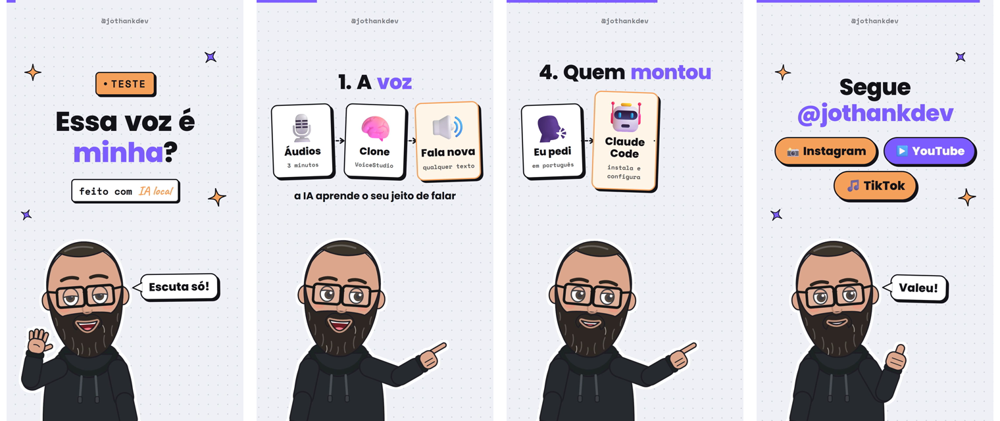
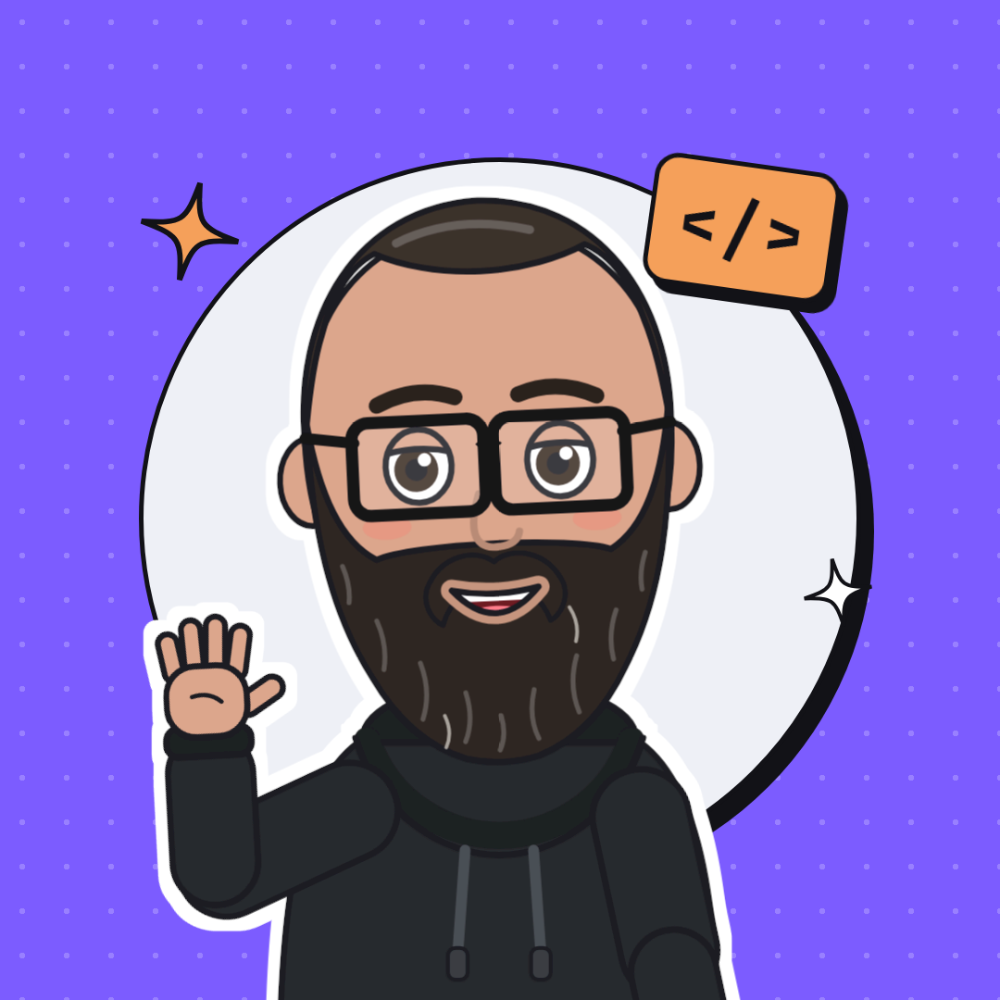

# Reels com avatar e voz clonada

Você escreve um roteiro em JSON e sai um reel vertical (9:16) pronto para postar: um avatar
desenhado a partir das suas fotos, falando com a sua voz clonada, com a boca sincronizada,
animações e textos na tela.

Com o VoiceStudio, a voz e o vídeo rodam **no seu computador, de graça**: nenhum áudio seu vai para a nuvem.



▶️ **[Assista ao vídeo de exemplo](videos/minha-voz-clonada.mp4)** (39 s, com som). A voz é
clonada e o avatar é desenhado em código.

Feito por [@jothankdev](https://www.instagram.com/jothankdev), com vídeos sobre IA e desenvolvimento
de software no [Instagram](https://www.instagram.com/jothankdev),
no [YouTube](https://www.youtube.com/@jothankdev) e no [TikTok](https://www.tiktok.com/@jothankdev).
Se o projeto te ajudou, deixe uma ⭐.

## Como funciona

```
roteiros/meu-video.json ──► voz (sua voz clonada, gravação ou voz pronta)
                                │
avatar/avatar.json ─────────────┼──► boca sincronizada com o áudio
                                │
                                ▼
                     Remotion (React) renderiza ──► videos/meu-video.mp4
```

| Peça | O que faz |
|---|---|
| [Remotion](https://www.remotion.dev/) | Monta o vídeo com componentes React: cenas, animações e o avatar em SVG. |
| [VoiceStudio](https://github.com/debpalash/VoiceStudio) + VoxCPM2 | Clona a sua voz a partir de áudios curtos seus e fala qualquer texto. Tudo local, na placa de vídeo. |
| [faster-whisper](https://github.com/SYSTRAN/faster-whisper) | Ouve cada fala gerada e confere se bate com o roteiro. Se não bater, gera de novo. |
| `scripts/build_reel.py` | Junta tudo: gera a voz, mede a boca quadro a quadro e chama o Remotion. |
| [Claude Code](https://claude.com/claude-code) (opcional) | Com a skill `criar-reel`, escreve o roteiro e renderiza a partir de um pedido em português. |

## 1. Instale o básico

Você precisa de Node 18+, Python 3.10+ e FFmpeg.

**Windows:**

```powershell
winget install OpenJS.NodeJS.LTS
winget install Gyan.FFmpeg
winget install astral-sh.uv
# feche e abra o terminal, depois, na pasta do projeto:
npm install
uv venv .venv --python 3.12
uv pip install --python .venv\Scripts\python.exe -r requirements.txt edge-tts
```

No Windows, rode os scripts com `.venv\Scripts\python` no lugar de `python`.

**macOS / Linux:**

```bash
brew install node ffmpeg        # no Linux: Node 18+ (pelo nvm) e sudo apt install ffmpeg python3-venv
npm install
python3 -m venv .venv
.venv/bin/pip install -r requirements.txt edge-tts
```

Nos comandos abaixo, `python` é o Python do `.venv`. Na primeira renderização, o Remotion baixa
o próprio Chrome.

## 2. Primeiro vídeo (sem clonar nada)

Use uma voz pronta da Microsoft (edge-tts, precisa de internet) para ver tudo funcionando:

```bash
python scripts/build_reel.py roteiros/o-que-e-api.json --motor edge --frame 90   # prévia de 1 quadro, em out/
python scripts/build_reel.py roteiros/o-que-e-api.json --motor edge              # vídeo em videos/o-que-e-api.mp4
```

Para ajustar o visual ao vivo, abra o editor do Remotion: `npm run studio`.

## 3. Seu avatar

O avatar é desenhado em código (`src/avatar/SvgAvatar.tsx`), e a aparência fica em
`avatar/avatar.json`. O que vem no repositório é o meu: troque pelo seu.

```json
{
  "modo": "svg",
  "svg": {
    "pele": "#DCA68C",
    "rosto": "oval",
    "corpo": "magro",
    "palpebras": true,
    "cabelo": {"estilo": "entradas", "cor": "#3B312B"},
    "olhos": "#3A2A22",
    "sobrancelhas": "#2A211D",
    "oculos": {"formato": "retangular", "cor": "#141418"},
    "barba": "longa",
    "corBarba": "#2F2723",
    "roupa": {"tipo": "moletom", "cor": "#26292D", "detalhe": "#3A3E43", "cordao": "#4A4F55"},
    "brinco": false
  }
}
```

| Campo | Opções |
|---|---|
| `rosto` | `oval`, `redondo` |
| `corpo` | `magro`, `normal`, `cheinho` |
| `cabelo.estilo` | `cacheado`, `curto`, `liso`, `longo`, `raspado`, `entradas`, `careca` |
| `barba` | `nenhuma`, `rala`, `curta`, `cheia`, `longa` (e `bigode`: `true`/`false`) |
| `oculos` | `false` ou `{"formato": "redondo" \| "quadrado" \| "retangular", "cor": "#hex"}` |
| `roupa.tipo` | `moletom`, `camiseta`, `camisa` |
| cores | qualquer hex: pegue a cor da pele no meio-tom da bochecha, sem sombra nem brilho |

Mudou alguma coisa? Rode a prévia com `--frame 60` e compare com uma foto sua.

**Atalho com o Claude Code:** mande 3 ou 4 selfies e peça "ajusta o avatar a partir dessas fotos".

**Foto de perfil:** a composição `Perfil` usa o mesmo avatar e gera uma imagem 1080×1080 para
Instagram, YouTube e TikTok:

```bash
npx remotion still src/index.ts Perfil perfil/foto.png
```



## 4. Sua voz

Escolha o campo `voz.motor` no roteiro (ou passe `--motor`):

| Motor | Custo | Como fica | O que precisa |
|---|---|---|---|
| `edge` | grátis | voz pronta, natural | internet |
| `arquivo` | grátis | **a sua voz de verdade** | gravar as falas |
| `voicestudio` | grátis | **a sua voz clonada** | placa de vídeo, VoiceStudio aberto |
| `elevenlabs` | pago | voz clonada na nuvem | `ELEVENLABS_API_KEY` |
| `espeak` | grátis | robótica | só para rascunho |

No `auto`, o script tenta nesta ordem: gravação, VoiceStudio, ElevenLabs, edge-tts e espeak.

### Clonando a sua voz (VoiceStudio + VoxCPM2)

1. Baixe o [VoiceStudio](https://github.com/debpalash/VoiceStudio/releases), abra e deixe ele
   instalar o ambiente local. Na lista de motores, instale o **VoxCPM2**.
2. Separe de 1 a 3 minutos de áudio **só com você falando**, sem música e sem outras vozes.
   Áudios do WhatsApp servem.
3. Crie o perfil (com o VoiceStudio aberto):

   ```bash
   python scripts/clonar_voz_voicestudio.py meus-audios/*.ogg --nome SeuNome --idioma pt
   ```

   O script escolhe sozinho o trecho mais limpo, de uns 12 s, e cria o perfil no VoiceStudio.
4. No roteiro, aponte para o perfil:

   ```json
   "voz": {"voz_voicestudio": "SeuNome", "modelo_voicestudio": "voxcpm2"}
   ```

5. Renderize conferindo cada fala:

   ```bash
   python scripts/build_reel.py roteiros/meu-video.json --motor voicestudio --conferir 3
   ```

   O `--conferir 3` transcreve cada fala com o Whisper e, se não bater com o roteiro, gera de novo
   (até 3 vezes). O log mostra o que foi ouvido: leia antes de postar.

Testado numa RTX 3060 de 12 GB. O VoiceStudio aberto ocupa uns 7 GB da placa: feche quando terminar.

> **Por que o VoxCPM2?** Ele clona voz, fala português e tem licença Apache-2.0, que permite uso
> comercial. O OmniVoice, motor padrão do VoiceStudio, é CC-BY-NC: só para uso não comercial.

### O que aprendi clonando a voz

- **Um "iru" no começo de toda fala** era culpa do trecho de referência. O VoxCPM2 continua o
  áudio de referência; se ele termina no meio de uma palavra, toda fala nova começa terminando
  essa palavra. Por isso o `clonar_voz_voicestudio.py` corta entre pausas de verdade e põe
  silêncio nas pontas. O `build_reel.py` ainda detecta esse estalo e gera a fala de novo.
- **Deixe o VoiceStudio transcrever a referência.** Com a transcrição do Whisper small, o
  VoxCPM2 pulava a primeira palavra das falas; com a do large-v3-turbo, inventava sílabas no começo.
- **Evite começar uma fala com "E" sozinho** ("E o melhor…"): ele costuma engolir ou embolar.
- **Nomes estrangeiros saem melhor escritos como se fala**, em `voz.pronuncia`:
  `{"Remotion": "Rimóshon", "YouTube": "iutúbi"}`. Na tela continua o nome certo.

### Gravando com a sua voz de verdade

```bash
python scripts/build_reel.py roteiros/meu-video.json --texto-gravacao
```

Esse comando mostra o texto de cada cena. Grave tudo num áudio só, com uns 2 s de pausa entre
as cenas, salve em `gravacoes/meu-video.m4a` e ponha `"audio_unico": "gravacoes/meu-video.m4a"`
no roteiro. O script corta nas pausas sozinho.

Gravou várias tentativas em áudios separados? O `scripts/montar_gravacao.py` transcreve todos,
escolhe a última tentativa boa de cada cena e monta o roteiro:

```bash
python scripts/montar_gravacao.py roteiros/meu-video.json gravacoes/meu-video/*.ogg
```

## 5. Escreva o roteiro

Cada vídeo é um arquivo em `roteiros/`. Um exemplo mínimo:

```json
{
  "id": "meu-video",
  "titulo": "O que é Docker?",
  "assinatura": "@seuperfil",
  "voz": {"motor": "auto", "voz_edge": "pt-BR-AntonioNeural"},
  "cenas": [
    {"layout": "hook", "titulo": "O que é *Docker*?", "subtitulo": "em _30s_", "pose": "acena",
     "fala": "Já ouviu falar de Docker e ficou boiando? Bora entender em trinta segundos."},
    {"layout": "lista", "titulo": "Pra que *serve*", "pose": "aponta",
     "itens": [{"emoji": "📦", "texto": "Empacota o app"}, {"emoji": "🚀", "texto": "Roda em todo lugar"}],
     "fala": "Ele empacota o seu app com tudo o que ele precisa, e roda igual em qualquer máquina."},
    {"layout": "cta", "titulo": "Salva pra *depois*", "pose": "joinha",
     "fala": "Salva esse vídeo e me segue pra mais dicas!"}
  ]
}
```

| Layout | Campos | Quando usar |
|---|---|---|
| `hook` | `titulo`, `badge?`, `subtitulo?` | abertura com pergunta ou promessa |
| `fluxo` | `titulo?`, `itens[2-4]{emoji,texto,detalhe?}`, `legenda?` | processo, A → B → C |
| `lista` | `titulo?`, `itens[2-5]{emoji?,texto,detalhe?}`, `numerada?` | passos, dicas, exemplos |
| `codigo` | `titulo?`, `pedido`, `resposta` | comando e resultado |
| `comparacao` | `titulo?`, `esquerda{titulo,itens,tom}`, `direita{...}` | antes × depois, certo × errado |
| `cta` | `titulo`, `botoes?` | fechamento: seguir, salvar, comentar |

- Toda cena tem `fala` e pode ter `pose` (`idle`, `acena`, `aponta`, `explica`, `duvida`, `joinha`),
  `expressao` (`feliz`, `surpreso`, `pensativo`, `serio`) e `bolha` (balão de até 3 palavras).
- No texto da tela, `*palavra*` fica roxa e `_palavra_` fica laranja, em letra cursiva.

**Dicas para um reel bom:** gancho nos 2 primeiros segundos, de 4 a 6 cenas, de 20 a 45 s no
total, uma ideia por cena, frases faladas de até 15 palavras. A tela mostra palavras-chave e a fala
explica.

Veja os dois roteiros de exemplo em [`roteiros/`](roteiros/). O `minha-voz-clonada.json` é o do
vídeo acima; para gerá-lo de novo, troque `voz_voicestudio` pelo seu perfil.

## 6. Com o Claude Code (opcional)

Abra a pasta no [Claude Code](https://claude.com/claude-code) e peça:

> cria um reel sobre "o que é Docker"

A skill [`criar-reel`](.claude/skills/criar-reel/SKILL.md) escreve o roteiro, confere as prévias,
renderiza e te entrega o MP4. Também ajusta o avatar a partir de fotos. Foi assim que este projeto
inteiro foi montado: eu pedia em português e o Claude Code instalava, programava e testava.

O Claude Code é pago (precisa de uma assinatura do Claude). O resto do projeto funciona sem ele.

## Estrutura

| Caminho | O quê |
|---|---|
| `roteiros/*.json` | um arquivo por vídeo: cenas, falas, textos e poses |
| `avatar/avatar.json` | aparência do avatar |
| `src/` | componentes do vídeo: cenas, avatar SVG, animações, foto de perfil |
| `scripts/build_reel.py` | voz, sincronia da boca e render |
| `scripts/clonar_voz_voicestudio.py` | cria o perfil da sua voz no VoiceStudio |
| `scripts/montar_gravacao.py` | monta as falas a partir de várias gravações suas |
| `.claude/skills/criar-reel/` | skill do Claude Code |
| `videos/` | vídeos prontos |

## Problemas comuns

- **Emoji aparece como quadrado:** instale uma fonte de emoji colorida (no Linux, `fonts-noto-color-emoji`).
- **Texto estourando a tela:** encurte o texto. Não diminua a fonte: o reel é visto no celular.
- **O VoiceStudio não responde:** confira se ele está aberto em `http://localhost:3900`, ou
  aponte `VOICESTUDIO_URL` para onde ele estiver.
- **Acentos quebrando o log no Windows:** rode com `PYTHONUTF8=1`.
- **O render não acha o Chrome:** passe o caminho em `REMOTION_CHROMIUM`.

## Ética

Clone só a sua própria voz, ou a de alguém que autorizou. Quando postar, marque que o vídeo usa
IA: YouTube, Instagram e TikTok têm uma opção para isso na hora de publicar.

## Licença

O código está sob a [licença MIT](LICENSE): use, mude e distribua à vontade.

- O vídeo `videos/minha-voz-clonada.mp4` e a imagem `perfil/jothankdev.png` têm a minha voz e o
  meu avatar. Eles servem de exemplo e não entram na licença MIT: para os seus vídeos, use o seu
  avatar e a sua voz.
- O [Remotion](https://www.remotion.dev/license) tem licença própria: é gratuito para pessoas
  físicas e empresas com até 3 funcionários. Acima disso, a empresa precisa de uma licença paga.
- Cada motor de voz do VoiceStudio tem a sua licença. O VoxCPM2 é Apache-2.0; o OmniVoice é só para
  uso não comercial.
